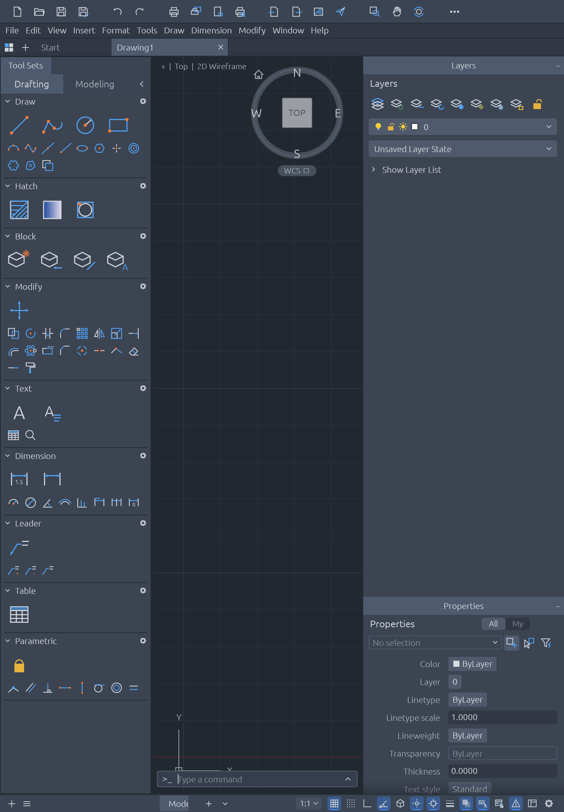

# CADCraft for iPadOS (fork)

<p align="center">
  
  <br>
  <sub>CADCraft on iPadOS, in portrait (iPad Air 11-inch simulator).</sub>
</p>

This fork exists only for the **iPadOS port** of CADCraft, an open-source, clean-room computer-aided design
and drafting application written in Rust. To learn about the project itself (features, DWG and DXF support,
desktop and web builds, downloads, the other Crafting Apps, contributing), read the upstream README:
**[storytold/cadcraft](https://github.com/storytold/cadcraft#readme)**.

## What this fork adds

- **`apps/cadcraft-ios`**: a Rust static-library runner (single UIKit window scene attached to winit's
  window, safe-area insets taken from UIKit every frame, settings and autosave in the app container). Open
  imports a copy of the file into the app container and remembers where it came from; Save reserves a file
  there, and a change tracker takes each saved drawing to the export picker the first time and to the
  remembered location after. Also: a hardware keyboard through GameController (Enter, arrows, Escape, Tab,
  function keys, typed text and Backspace with hold-to-repeat, and Cmd/Ctrl shortcuts, which winit never
  delivers on iPadOS), Apple Pencil hover and pose, the system text clipboard and links through UIKit, and
  the panel layout kept between runs. The desktop-only parts (control server,
  SpaceMouse, native menu) are not part of it.
- **Pickers that answer later** (`crates/ui-egui/src/picks.rs`): `Services` gains `begin_pick` and
  `poll_pick`, because UIDocumentPicker needs the main thread's run loop that egui draws on, so a blocking
  `pick_open` would deadlock. Every file dialog (Open, Save As, Import, Export, Publish, Plot, XATTACH...)
  goes through `CadApp::pick`; where the new hooks are not set (desktop, web) the blocking closures run as
  before.
- **`packaging/ios`**: the Xcode project that links the library into an iPad app bundle, with a bundle
  validator and tests, DXF/DWG/DWT document types and an SVG viewer type. See its [README](packaging/ios/README.md).
- **`cargo xtask ios`**: build, install and launch on the Simulator or a physical iPad
  (`--sim`, `--device --device-id <id> --team <id> [--bundle-id <dev id>]`).
- **No Discord links.** The macOS menu item, the About window link, the packaging help links and their
  strings in every language are gone.

## Status

Verified in the iPad Air 11-inch M3 simulator (iPadOS 26.2, 2026-10-13): the app builds, installs, launches
and draws its interface (tool bar, Tool Sets, Layers and Properties palettes, command line, status bar) in
portrait inside the safe area.

On a physical iPad Air 13-inch (M3), reported by the maintainer (2026-10-14): the app installs, launches and
runs. With a hardware keyboard, typing into the command line works (letters, digits, Shift, `@`, Backspace,
hold-to-repeat), and Cmd+O opens the Files picker and Cmd+S saves.

**Not yet verified:** opening and saving a drawing end to end through the Files picker, touch, the clipboard
and links, the saved layout across launches, multitasking, landscape. Apple Pencil hover (the crosshair and
snap markers following the floating tip) and pressure/tilt/roll are written and unit-tested on the host but
not yet exercised on a device; no CAD tool uses pressure or tilt yet, and the Pencil double-tap and squeeze
are not read. The Pencil otherwise works as a touch pointer through winit. This is a first bootstrap, not a
full hardware sign-off.

## Build and run

Requires macOS with Xcode and the Rust targets `aarch64-apple-ios`, `aarch64-apple-ios-sim` and
`x86_64-apple-ios`.

```sh
cargo xtask ios --sim          # build, boot, install and launch on the iPad simulator
cargo xtask ios --device --device-id <udid> --team <team id> --bundle-id <your.dev.bundle.id>
cargo test -p cadcraft-ios --lib
cargo test -p cadcraft-ui-egui --lib picks
python3 -m unittest discover -s packaging/ios/tests -v
```

Contributor rules (clean-room, never crash, layering, assets) are in [`AGENTS.md`](AGENTS.md).

## License and attribution

Dual-licensed MIT OR Apache-2.0, as upstream. Assets are listed in [`ATTRIBUTION.md`](ATTRIBUTION.md).
